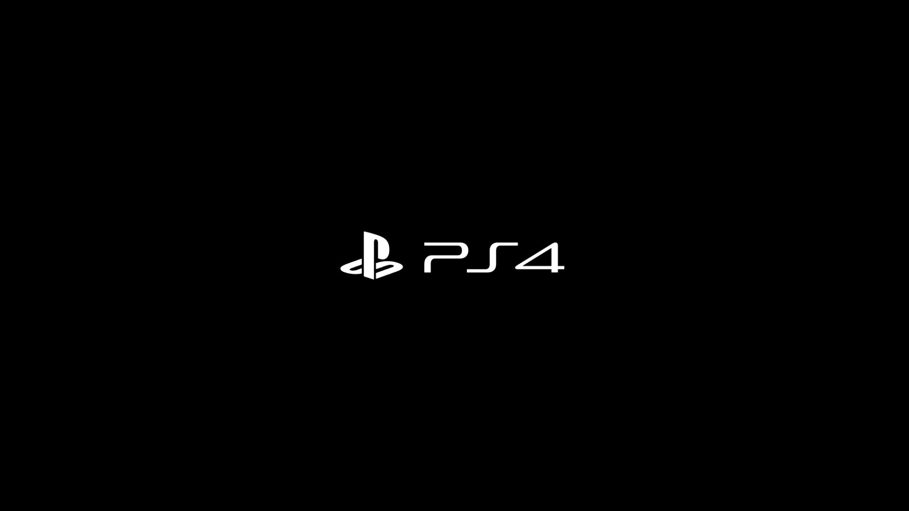
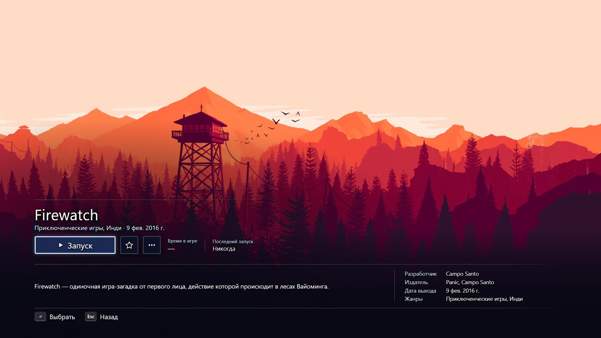
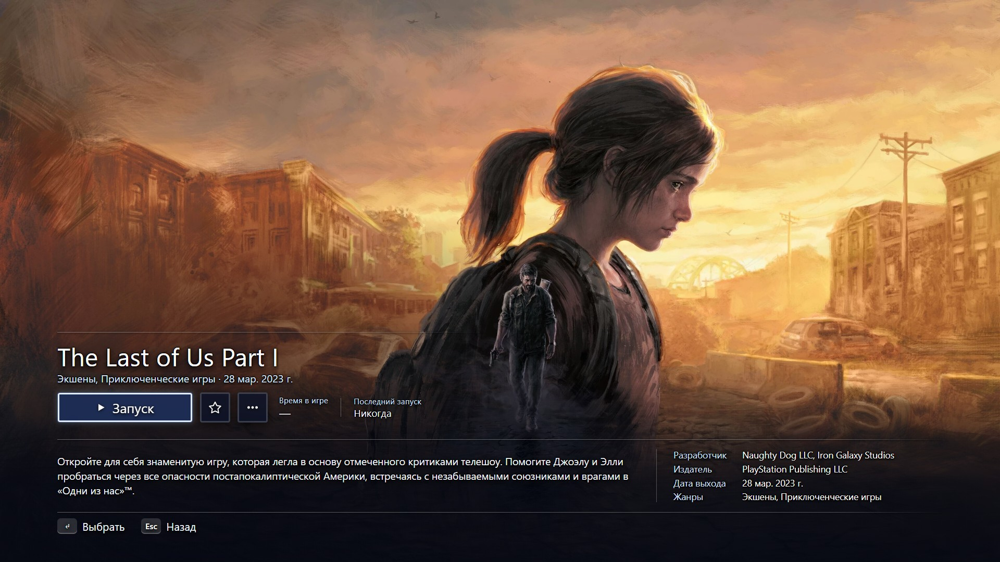
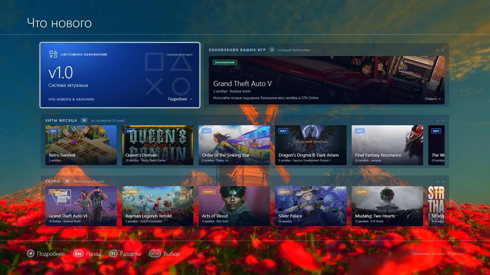
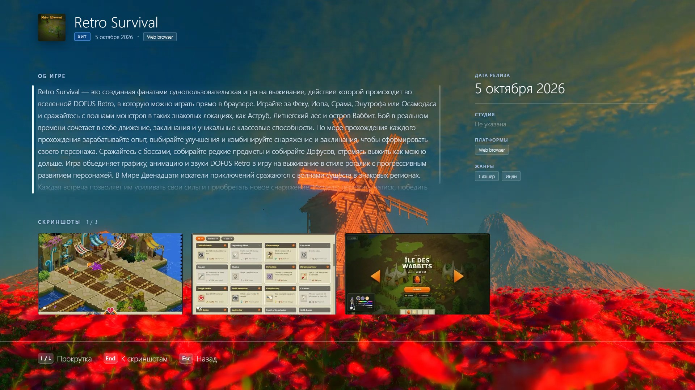
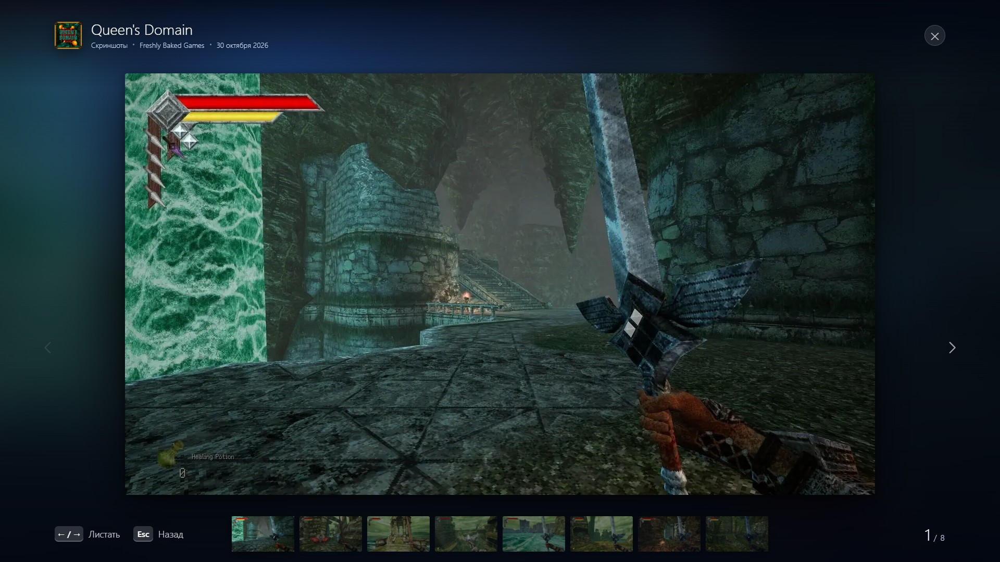
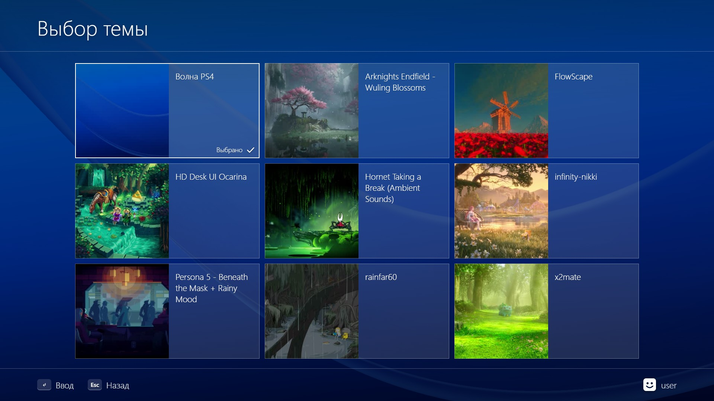
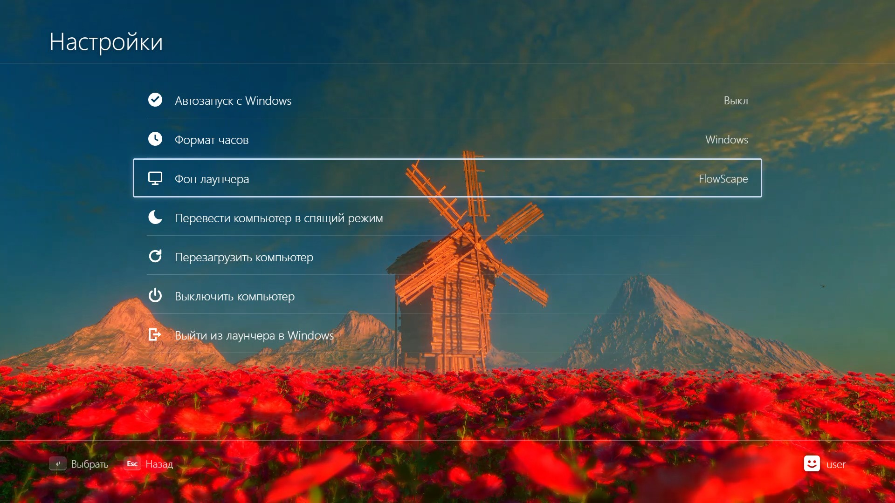

# PS4 Launcher

**Лаунчер игр для Windows в стиле PS4** · **A PS4-style game launcher for Windows**

[Русский](#русский) · [English](#english)

**Статус:** витрина проекта, исходный код пока не опубликован. · **Status:** project showcase, source code is not public yet.

> **Это не эмулятор PS4.** Лаунчер запускает обычные Windows-игры.
> **Not a PS4 emulator.** It launches regular Windows games.

## Скриншоты / Screenshots

| Заставка · Boot splash | Библиотека · Library |
|:---:|:---:|
|  |  |

| Выбор игры · Selected game | Страница игры · Game page |
|:---:|:---:|
|  |  |

| Страница игры · Game page | «Что нового» · What's New |
|:---:|:---:|
|  |  |

| Хаб новинки · Release hub | Просмотр скриншотов · Screenshot viewer |
|:---:|:---:|
|  |  |

| Выбор темы · Theme picker | Настройки · Settings |
|:---:|:---:|
|  |  |

---

## Русский

### О проекте

PS4 Launcher — личный некоммерческий проект: лаунчер Windows-игр с интерфейсом домашнего экрана PlayStation 4. Он запускает обычные `.exe` и `.lnk`, показывает библиотеку, страницы игр, ленту «Что нового» и настройки. Это не эмулятор: PS4-консоль и образы игр не нужны.

Вся сцена собрана в 1920×1080 и масштабируется под окно целиком; интерфейс и описания игр — на русском.

### Возможности

**Заставка и вход**
- Чёрная заставка с логотипом PS4, экран «С возвращением в PlayStation» и фоновая волна.
- Музыка заставки и библиотеки, звуки меню; вход по кнопке PS/Guide или с клавиатуры и мыши.

**Библиотека**
- Горизонтальная карусель с обложками, пружинной анимацией и увеличением активной плитки.
- Избранное поднимается в начало списка, есть системная плитка «Что нового».
- Добавление игр через проводник (`.exe`, `.lnk`, `.bat`), профиль и часы.

**Страница игры**
- Полноэкранный арт, название, жанры, дата релиза, разработчик, издатель и описание.
- Время в игре и последний запуск.
- Меню игры: запуск, избранное, переименование, выбор обложки, выбор фона, удаление.

**Оформление**
- Автоматический подбор обложек из SteamGridDB, фонов и описаний из IGDB и Steam.
- Ручной выбор обложки или фона из найденных вариантов.
- Сжатие картинок в WebP и перевод описаний на русский.

**«Что нового»**
- Обновления установленных игр, хиты месяца и ожидаемые релизы.
- Карточка системного обновления лаунчера.
- Хаб новинки с описанием, метаданными и скриншотами; полноэкранный просмотр кадров.
- Фоновая догрузка и кэш — лента открывается без ожидания.

**Фон и темы**
- Волна PS4 по умолчанию: процедурная ткань на WebGL2, один лист, OIT без сортировки; пауза в игре и при скрытом окне.
- Видео-темы: `.mp4`, `.webm` или `.m4v` в папке `themes/` автоматически появляется в каталоге.
- Сетка тем показывает JPEG-превью и не загружает видео; выбор сохраняется.
- Видео всегда без звука; на заставке и приветствии играет волна, видео включается после входа в библиотеку кроссфейдом.

**Запуск и возврат**
- Запуск игры и определение названия из метаданных `.exe`; поддержка ярлыков `.lnk`.
- Слежение за окном игры, возврат фокуса и двухфазный возврат в лаунчер.
- Учёт времени в игре; музыка приглушается на старте и плавно гаснет.

**Управление**
- Клавиатура, мышь, геймпады Xbox (XInput) и PlayStation.
- Подсказки кнопок в подвале меняются под текущее управление.

**Настройки**
- Автозапуск с Windows, формат часов, фон лаунчера.
- Спящий режим, перезагрузка, выключение компьютера и выход в Windows.

### Технологии

Python и pywebview (Edge WebView2), HTML/CSS/JS без сборки, WebGL2 для фона. Обложки и метаданные — SteamGridDB, IGDB и Steam; картинки — WebP. Платформа: Windows 10/11.

### Статус

Личный некоммерческий проект. Исходный код пока не опубликован: репозиторий — витрина со скриншотами и описанием. Интерфейс на русском языке.

### Дисклеймер

Проект не связан с Sony Interactive Entertainment и не одобрен ею. PlayStation — торговая марка Sony. Это не эмулятор PS4. Обложки, арты и звуки принадлежат их правообладателям и используются только для оформления личного некоммерческого проекта.

---

## English

### About

PS4 Launcher is a personal non-commercial project: a Windows game launcher styled after the PlayStation 4 home screen. It launches regular `.exe` and `.lnk` files and provides a game library, game pages, a What's New feed and settings. It is not an emulator: no PS4 console or game images are required.

The whole scene is laid out for 1920×1080 and scaled to fit the window; the interface and game descriptions are currently in Russian.

### Features

**Boot and welcome**
- Black PS4-logo boot splash, a "Welcome back to PlayStation" screen and the animated wave background.
- Boot and library music, menu SFX; enter with the PS/Guide button, keyboard or mouse.

**Library**
- Horizontal cover carousel with spring animation and an active tile that grows.
- Favorites are moved to the front; a system "What's New" tile sits next to the games.
- Add games through a file dialog (`.exe`, `.lnk`, `.bat`), profile and clock on one screen.

**Game page**
- Full-screen art, title, genres, release date, developer, publisher and description.
- Play time and last launch.
- Game menu: launch, favorite, rename, choose cover, choose background, remove.

**Artwork**
- Automatic covers from SteamGridDB; backgrounds and descriptions from IGDB and Steam.
- Manual cover or background selection from the fetched candidates.
- WebP image compression and Russian descriptions.

**What's New**
- Updates for installed games, recent hits and upcoming releases.
- A system update card for the launcher.
- A release hub with description, metadata and screenshots, plus a full-screen screenshot viewer.
- Background prefetch and caching so the feed opens without waiting.

**Background and themes**
- PS4 wave by default: a procedural cloth surface in WebGL2, a single sheet, order-independent transparency without sorting; paused in game and when the window is hidden.
- Video themes: any `.mp4`, `.webm` or `.m4v` dropped into `themes/` appears in the catalog automatically.
- The theme grid uses JPEG previews and never loads videos; the selected theme is saved.
- Videos are always muted; the wave plays on the splash and welcome screen, and video crossfades in after entering the library.

**Launch and return**
- Launch a game and infer its title from `.exe` metadata; `.lnk` shortcuts are supported.
- Watches the game window, restores focus and performs a two-phase return to the launcher.
- Tracks play time; music ducks on launch and fades out smoothly.

**Input**
- Keyboard, mouse, Xbox (XInput) and PlayStation gamepads.
- Footer button hints follow the current input device.

**Settings**
- Start with Windows, clock format, launcher background.
- Sleep, restart, shut down and exit to Windows.

### Tech

Python and pywebview (Edge WebView2), HTML/CSS/JS with no build step, WebGL2 for the background. Artwork and metadata from SteamGridDB, IGDB and Steam; images in WebP. Platform: Windows 10/11.

### Status

Personal non-commercial project. Source code is not public yet: this repository is a showcase with screenshots and a feature overview. The interface is in Russian.

### Disclaimer

This project is not affiliated with or endorsed by Sony Interactive Entertainment. PlayStation is a trademark of Sony. It is not a PS4 emulator. Game artwork and audio belong to their respective owners and are used only for this personal, non-commercial project.
