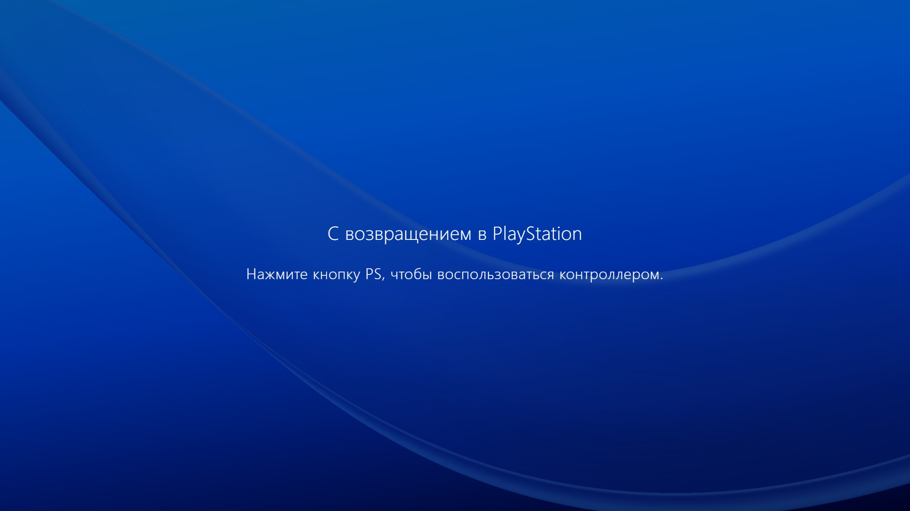
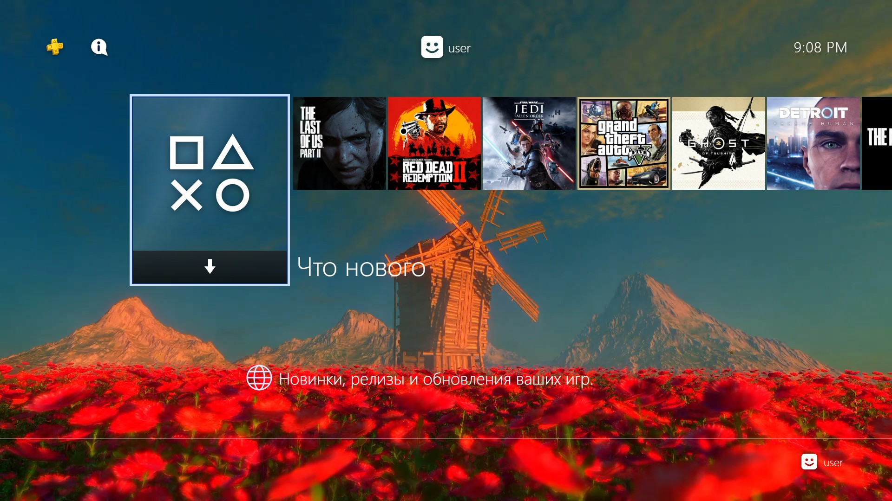
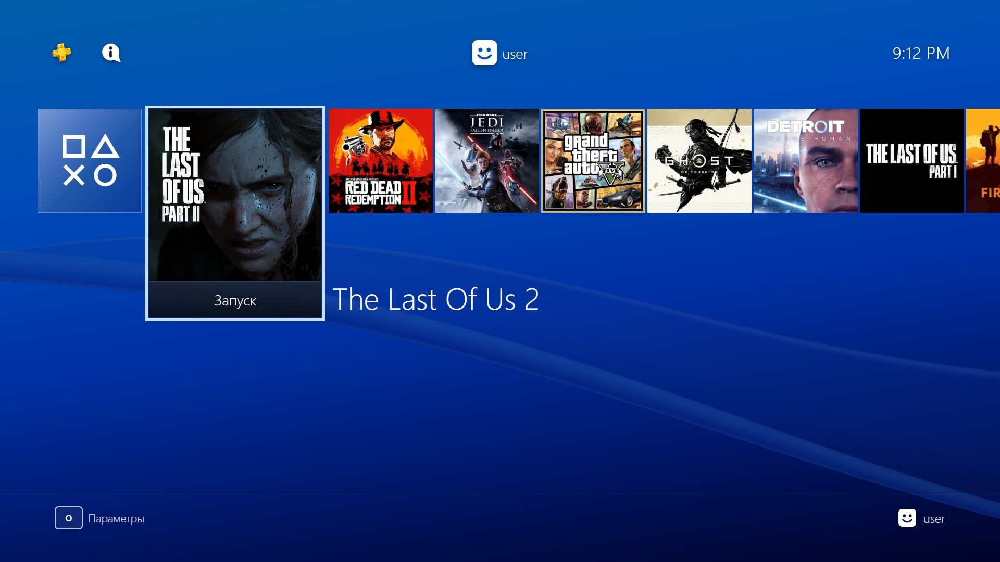

# PS4 Launcher

**Лаунчер игр для Windows в стиле PS4** · **A PS4-style game launcher for Windows**

[Русский](#русский) · [English](#english)

**Статус:** это витрина проекта — исходный код пока не опубликован. · **Status:** this is a project showcase — the source code is not public yet.

> **Это не эмулятор PS4.** Лаунчер запускает обычные Windows-игры.
> **Not a PS4 emulator.** It launches regular Windows games.

## Скриншоты / Screenshots

| Заставка · Boot splash | Библиотека · Library |
|:---:|:---:|
|  |  |

| Выбор игры · Selected game | «Что нового» · What's New |
|:---:|:---:|
|  |  |

| Страница игры · Game page |
|:---:|
|  |

| Хаб новинки · Release hub | Просмотр скриншотов · Screenshot viewer |
|:---:|:---:|
|  |  |

| Выбор темы · Theme picker | Настройки · Settings |
|:---:|:---:|
|  |  |

---

## Русский

### О проекте

PS4 Launcher — личный проект: домашний экран PlayStation для Windows-игр. Это не эмулятор и не замена консоли — просто уютная оболочка, в которой игры запускаются с геймпада, с обложками, описаниями и знакомыми звуками. Хочется включить компьютер, сесть на диван и на пару секунд поверить, что это та самая приставка.

Интерфейс и описания — на русском.

### Что умеет

- **Знакомое начало.** Чёрная заставка с логотипом, экран «С возвращением в PlayStation», живая волна на фоне, музыка и вход по кнопке PS — или с клавиатуры и мыши.
- **Библиотека.** Горизонтальная лента обложек; выбранная игра плавно увеличивается. Любимые игры можно поднять в начало, а новую — добавить через проводник: название лаунчер подхватит сам.
- **Страница игры.** Большой арт, описание, жанры, дата выхода, разработчик и издатель. Видно, сколько вы играли и когда запускали игру в последний раз. Запуск, избранное, переименование, обложка, фон и удаление — здесь же.
- **«Что нового».** Обновления ваших игр, хиты месяца и то, что скоро выйдет.
- **Страница новинки.** У каждой новинки — описание, детали и скриншоты; кадры можно открыть на весь экран. Лента открывается сразу: картинки готовятся заранее.
- **Консольные переходы.** Открытие страниц, запуск игры и возвращение в библиотеку анимированы в духе PS4. Лаунчер остаётся работать в фоне, поэтому после закрытия игры вы попадаете обратно в оболочку, а не на рабочий стол.
- **Фон.** Собственная анимированная волна в стиле PS4; в игре она замирает.
- **Темы.** Положите видео в папку `themes` — оно автоматически появится в списке с превью, а переключение между темами идёт плавно. Выбор запоминается, видео всегда без звука. Заставка и приветствие остаются с волной: выбранная тема включается, когда вы входите в библиотеку.
- **Запуск и возврат.** Лаунчер запускает игру, находит её окно и возвращает фокус после выхода. Время игры считается само, а музыка на старте становится тише.
- **Управление.** Геймпад, клавиатура или мышь — подсказки внизу подстраиваются под то, чем вы пользуетесь.
- **Настройки.** Автозапуск с Windows, формат часов и фон лаунчера. Сон, перезагрузка, выключение и выход в Windows — рядом.

### Технологии

Python и pywebview (WebView2), интерфейс — HTML/CSS/JS. Обложки и описания — SteamGridDB, IGDB и Steam. Windows 10/11.

### Статус

Личный некоммерческий проект. Исходный код пока не опубликован: здесь только витрина со скриншотами и рассказом о том, что уже работает. Интерфейс на русском.

### В планах

- Доработка волны в стиле PS4.
- Ускорение запуска и плавная работа с большими библиотеками.
- Поддержка разных разрешений и масштабирования Windows.
- Подготовка отдельной сборки с установщиком.

### Дисклеймер

Проект не связан с Sony Interactive Entertainment и не одобрен ею. PlayStation — торговая марка Sony. Это не эмулятор PS4. Обложки, арты и звуки принадлежат их правообладателям и используются только для оформления личного некоммерческого проекта. Перед публикацией готовой сборки права на эти материалы нужно проверить отдельно.

---

## English

### About

PS4 Launcher is a personal project: a PlayStation home screen for Windows games. It is not an emulator or a console replacement — just a cozy shell where games launch with a gamepad, covers, descriptions and familiar sounds. The idea is to turn on the PC, sit back on the couch and, for a second, believe it is the real thing.

The interface and descriptions are in Russian.

### What it does

- **A familiar welcome.** Black boot splash with the logo, a "Welcome back to PlayStation" screen, a living wave in the background, music and the PS button to enter — or just use the keyboard and mouse.
- **Library.** A horizontal row of covers; the selected game grows smoothly. Favorites can be moved to the front, and a new game can be added through a file dialog — the launcher picks up its title automatically.
- **Game page.** Large art, description, genres, release date, developer and publisher. You can see how long you have played and when the game was last launched. Launch, favorite, rename, cover, background and remove are all here.
- **What's New.** Updates for your games, recent hits and upcoming releases.
- **Release page.** Each release has its own page with details and screenshots, and the shots open full screen. The feed opens right away: the images are prepared in advance.
- **Console transitions.** Opening pages, launching a game and returning to the library are animated in the spirit of PS4. The launcher keeps running in the background, so when a game closes you land back in the shell, not on the desktop.
- **Background.** An animated PS4-style wave of our own; it pauses while you are in a game.
- **Themes.** Drop a video into the `themes` folder and it appears in the list with a preview automatically; switching between themes is smooth. Your choice is saved, and videos are always muted. The splash and welcome screen stay with the wave; your theme starts when you enter the library.
- **Launch and return.** The launcher starts the game, finds its window and restores focus after you exit. Play time is tracked automatically, and the music gets quieter on launch.
- **Input.** Gamepad, keyboard or mouse — the hints at the bottom follow whatever you are using.
- **Settings.** Start with Windows, clock format and launcher background. Sleep, restart, shut down and exit to Windows are right there too.

### Tech

Python and pywebview (WebView2); the interface is HTML/CSS/JS. Covers and descriptions come from SteamGridDB, IGDB and Steam. Windows 10/11.

### Status

Personal non-commercial project. Source code is not public yet: this is just a showcase with screenshots and a story about what already works. The interface is in Russian.

### Roadmap

- More work on the PS4-style wave.
- Faster startup and smoother work with large libraries.
- Support for different resolutions and Windows scaling.
- A separate build with an installer.

### Disclaimer

This project is not affiliated with or endorsed by Sony Interactive Entertainment. PlayStation is a trademark of Sony. It is not a PS4 emulator. Game artwork and audio belong to their respective owners and are used only for this personal, non-commercial project. Before any build is published, the rights to these materials need to be checked separately.
